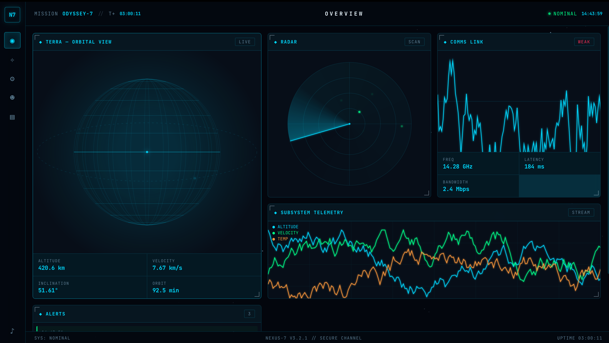

# nexus·7 — Deep Space Control Center

<p align="center">
  <b>A Retro-Futuristic Deep Space Control Center Built with Pure HTML, CSS, and JavaScript. No External Dependencies, No Backend.</b>
</p>

<p align="center">
  <a href="https://github.com/nowii-core/spacecontrol/blob/main/LICENSE">
    
  </a>
  
  
  
  
</p>

<p align="center">
  <a href="#-overview">Overview</a> •
  <a href="#-key-features">Features</a> •
  <a href="#-tech-stack">Tech Stack</a> •
  <a href="#-keyboard-shortcuts">Shortcuts</a> •
  <a href="#-quick-start">Quick Start</a> •
  <a href="#-contact">Contact</a>
</p>

---

</div>

## Overview

**nexus·7** is an immersive, retro-futuristic deep space control center interface that runs entirely in the browser. Built completely from scratch using native web technologies, it delivers a high-performance, cinematic experience without relying on heavy frameworks, external libraries, or backend servers. It features complex data visualizations, real-time telemetry simulations, and a highly detailed sci-fi user interface.

---

## Preview



> **Live Demo:** [nowii-core.github.io/spacecontrol/](https://nowii-core.github.io/spacecontrol/)

---

## Key Features

- **BIOS Boot Sequence:** Immersive startup experience with an ASCII logo and progressive log loading.
- **Animated Starfield:** Parallax scrolling effect featuring hundreds of stars.
- **3D Wireframe Planet:** Rotating planetary model complete with an orbiting satellite.
- **Dynamic Radar:** Interactive radar display with a sweeping line and dynamic blips.
- **Real-time Comms Waveform:** Visual signal strength indicator with animated communication waveforms.
- **Streaming Telemetry:** Real-time multi-line data feeds (altitude, velocity, temperature).
- **Interactive Star Map:** Navigable map displaying planets, flight routes, and the ship's current position.
- **Overview Dashboard:** Centralized hub displaying all live systems at a glance.
- **Navigation System:** Waypoint list with calculated distances in light-years (ly).
- **Systems Grid:** Detailed status monitoring for 12 subsystems featuring dynamic health bars.
- **Crew Roster:** Personnel database displaying roles, flight hours, missions completed, and clearance levels.
- **Mission Log:** Timestamped event logging categorized by severity levels (INFO / WARN / CRIT / OK).
- **Real-time Alert Stream:** Live feed of system alerts with color-coded priorities.
- **HUD:** Heads-up display featuring mission time, system uptime, and a live clock.
- **CRT Effects:** Authentic retro scanline overlay and sci-fi styled panel corners.
- **Event Generator:** Simulated random space events (solar flare, radiation spike, orbital burn).
- **Responsive & Theming:** Fully responsive layout with light/dark mode support.
- **Auto-Save:** Automatic state persistence via `localStorage`.
- **Keyboard Shortcuts:** Comprehensive keyboard navigation for quick access.

---

## Tech Stack

### Frontend
- **HTML5:** Semantic structure and UI framing.
- **CSS3:** Advanced layout with Grid and Flexbox, complex keyframe animations, `backdrop-filter`, custom properties, and `conic-gradient` for radar effects.

### Graphics & Logic
- **JavaScript (ES6+):** Native DOM manipulation, Canvas 2D API for rendering complex graphics (starfield, planet, radar), `requestAnimationFrame` for smooth 60fps animations, and `localStorage` for data persistence.

---

## Keyboard Shortcuts

| Key / Action | Command |
| :--- | :--- |
| **Click Rail** | Switch views (Overview / Navigation / Systems / Crew / Logs) |
| **Click ♪** | Mute / toggle audio |
| **Click Waypoint** | Set route to the selected planet |
| **ESC** | Close any active overlay |

---

## Quick Start

### Prerequisites
No build step, server, or package manager is required.

### Installation

1. **Clone the repository:**
   ```bash
   git clone https://github.com/nowii-core/spacecontrol.git
   cd spacecontrol
   ```

2. **Run the application:**
   Simply open the `index.html` file in your preferred modern web browser.

### Deployment (GitHub Pages)
To deploy this application via GitHub Pages:
1. Navigate to your repository **Settings**.
2. Go to the **Pages** section.
3. Under **Branch**, select `main` and choose the `/` (root) folder.
4. Click **Save**.

---

## Contact & Support

- **Maintainer:** [@nowii-core](https://github.com/nowii-core)
- **Bug Reports & Feature Requests:** If you encounter an issue or would like to suggest an improvement, open an [Issue](https://github.com/nowii-core/spacecontrol/issues) or submit a [Pull Request](https://github.com/nowii-core/spacecontrol/pulls).

---

<div align="center">
  <sub>Developed by <b>nowii-core</b></sub>
</div>
